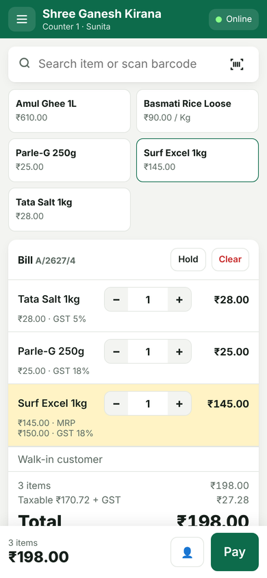
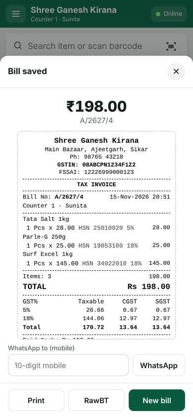
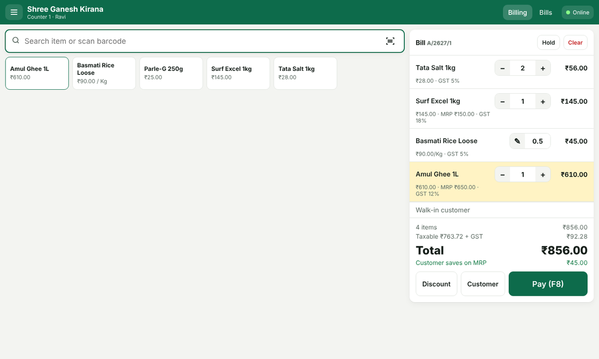

# Dukaan: counter billing that goes straight into TallyPrime

Dukaan is a free, self-hosted billing app (POS) for a shop whose books are in TallyPrime. Bill on a phone, a tablet or the counter PC, print a GST tax invoice or send it on WhatsApp, take cash, UPI, card or credit (udhaar). Each bill then goes into Tally on its own as a sales voucher, with the same number, items, HSN, CGST and SGST.

Dukaan never changes or deletes anything in Tally. It reads your items and ledgers and only ever **adds** new vouchers.

<table>
<tr>
<td></td>
<td></td>
</tr>
</table>

*Screenshots use made-up demo data.*

## What it does

### At the counter
- **Fast billing:** search by name, scan with a USB or Bluetooth barcode scanner, or with the phone's camera. Each scan beeps.
- **Quick buttons** for favourite items.
- **Loose items** (rice, dal, sugar): type the weight, or the amount in rupees and Dukaan works out the weight.
- **Prices include GST**, like shelf prices. MRP is shown, selling above MRP is blocked, and the bill shows what the customer saved.
- **Discounts** on a line or on the whole bill. Only the owner, or cashiers allowed to, can give them.
- **Payment:** cash (with change worked out), UPI (a QR with the amount filled in), card, split (e.g. part cash, part UPI), or credit on a customer's account in Tally.
- **Hold a bill** while you serve someone else.
- **Print** on an 80 mm or 58 mm thermal printer or on A4. On Android, Bluetooth printers work through the free RawBT app.
- **WhatsApp** the bill, with a link to the full invoice.
- **Works offline.** If the internet or the server is down, billing carries on. Bills are numbered and printed on the device and sent once it's back.

### GST
- Every bill is a proper **tax invoice** (or bill of supply / invoice-cum-bill of supply when exempt items are involved). It shows your GSTIN, a unique number per financial year (16 characters at most), the date, HSN, quantity, taxable value, CGST and SGST rate-wise, place of supply and reverse charge.
- **GST rates and HSN codes come from Tally.** An item without them can't be sold until it's fixed, so a wrong rate can't slip through.
- **One number series per counter**, e.g. A/2627/1, B/2627/1, starting again each April.
- **B2B bills:** the customer's GSTIN is checked. Bills of ₹50,000 or more to an unregistered buyer need their name and address (rule 46).
- **Returns** become credit notes against the original bill, with the same GST.
- **Cancelling:** a bill that hasn't reached Tally yet can be cancelled, and its number is reported as cancelled. Once it's in Tally, take the goods back as a return instead.
- **Reports:** sales by payment mode, cash in the drawer, GST by rate, the **HSN summary** (GSTR-1 table 12, B2B and B2C apart) and **documents issued** (table 13). Both download as CSV.

### Into Tally
Each bill becomes a **Sales voucher** in the voucher type you pick, using your own sales, CGST, SGST and round-off ledgers for each GST rate:
- cash bill: party is your Cash ledger;
- UPI or card bill: party is the bank ledger you pick for each;
- split payment: one sales voucher, plus a contra moving the UPI or card part out of Cash;
- credit bill: party is the customer (bill-wise, New Ref), plus a receipt for anything paid now;
- return: a credit note against the original bill.

Stock goes out of the godown you choose. Every figure is worked out again on the server before it goes. If anything disagrees (a GST rate changed in Tally, a number used twice, a total that doesn't add up), the bill waits for the owner to look at it. A bill whose answer from Tally is lost (network dropped) is looked up in Tally before being sent again, so it never goes in twice.

**E-invoices:** counter sales to consumers (B2C) don't need one. For a bill to a business with a GSTIN, if your e-invoicing applies, generate the e-invoice in Tally after the bill arrives there.

### For the owner
- Cashiers sign in with a PIN. You choose who can give discounts, take returns or give credit.
- Items page: selling price, MRP, barcodes (scan them in), loose, favourites. Kept in Dukaan; Tally's items aren't changed.
- Tally page: the connection, where bills go, bills waiting or refused, with the reason.
- Database backed up every night (45 days kept).

## Install

1. **Tally PC:** in TallyPrime, F1 Help › Settings › Connectivity: set *TallyPrime acts as* to **Both** and the port to **9000**. Keep your company open.
2. **Server:** on Unraid, Apps › search **dukaan** › Install, and set the owner password. Or use [docker-compose.yml](docker-compose.yml).
3. Open `http://SERVER-IP:2510`, sign in as the owner, and follow the **[setup guide](docs/INSTALL.md)**.

## Before you rely on it

Run Dukaan alongside your current billing for a week or two. Have your CA check a few bills and the vouchers they make in Tally, especially the GST rates and HSN codes on your items. Dukaan works out GST from what is in Tally, so a wrong rate in Tally will be wrong on the bill too.

## Licence

GPL-3.0. Dukaan is not made by or connected with Tally Solutions.
